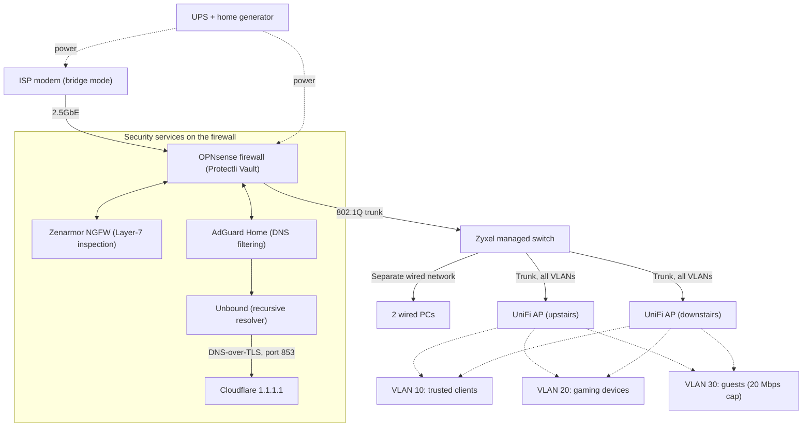
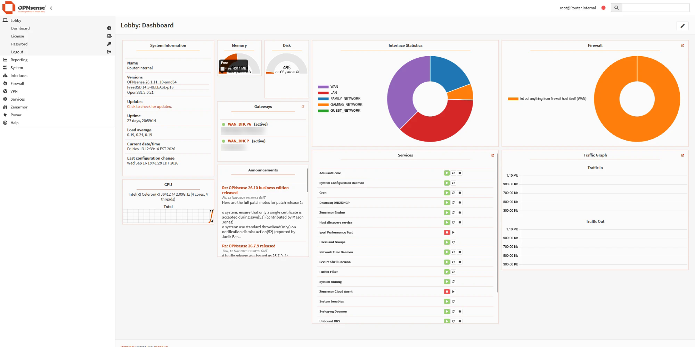
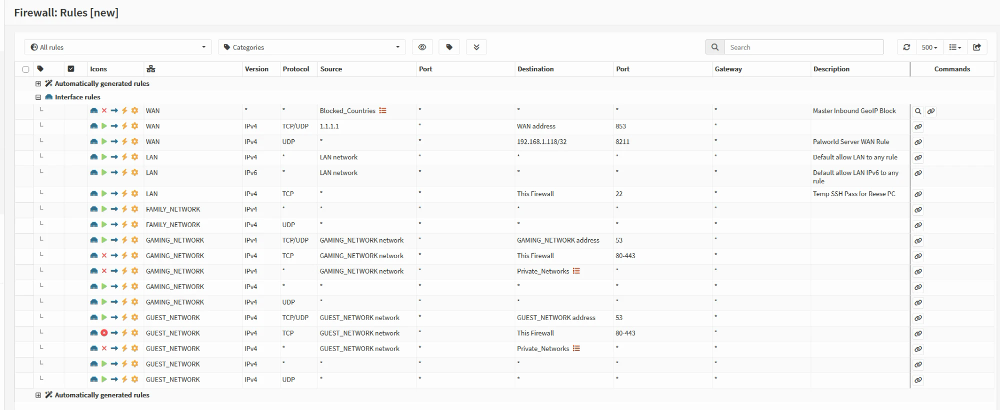
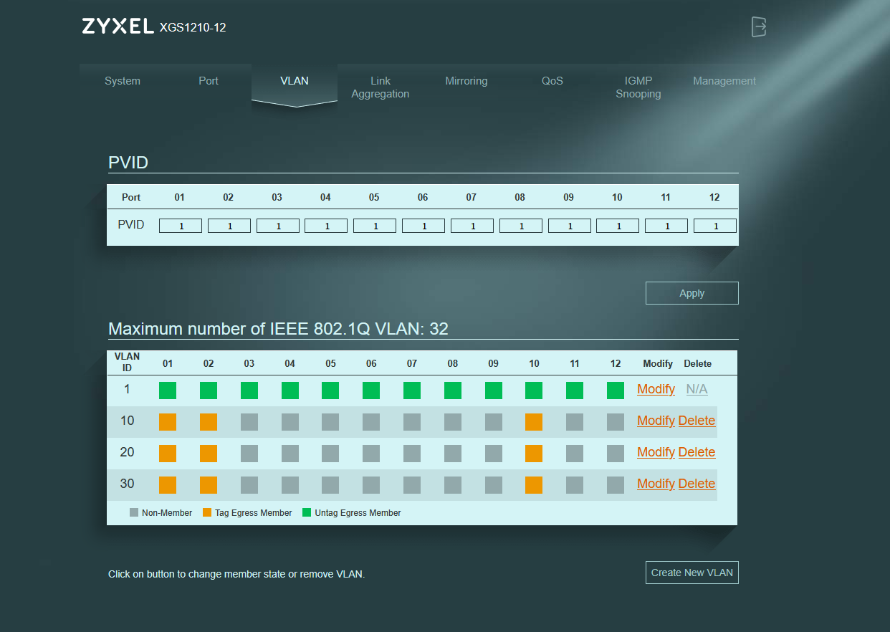
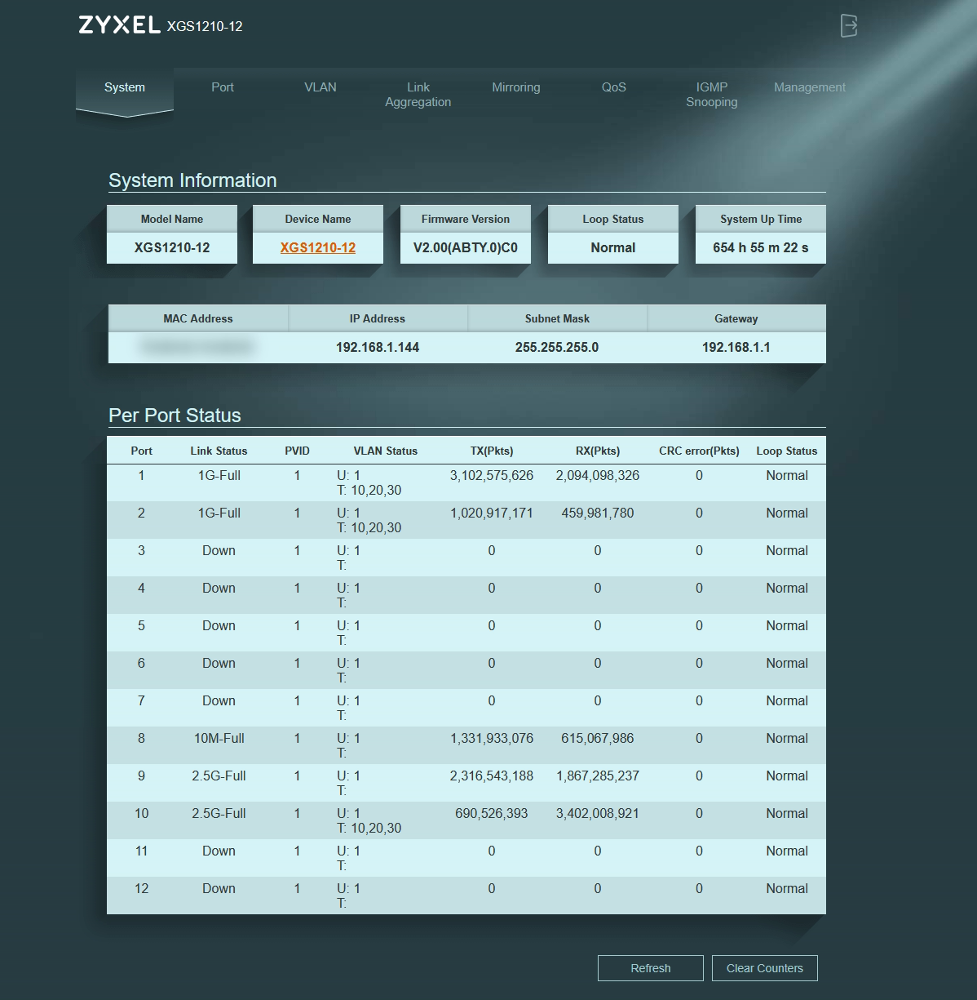
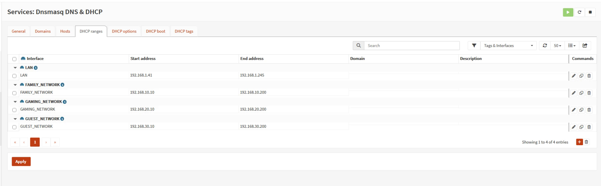
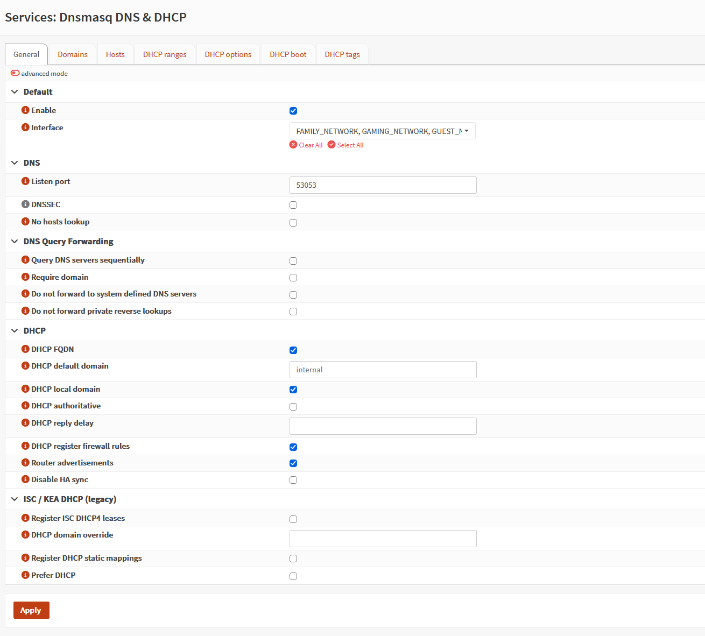
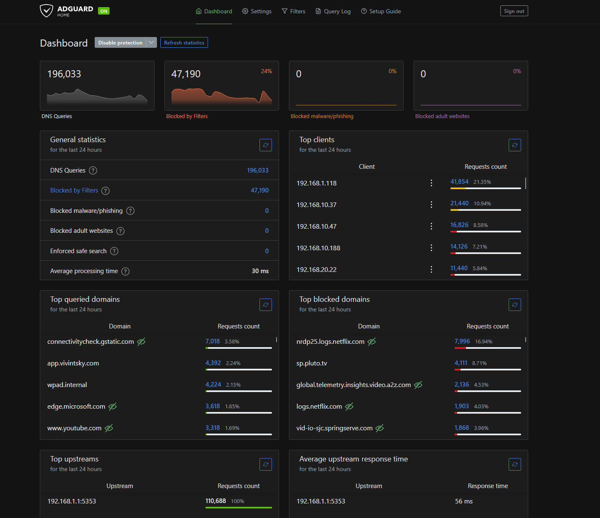
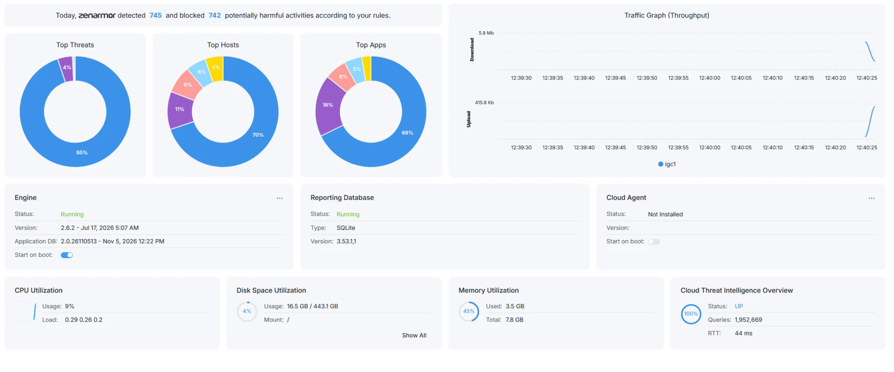

# Homelab Network Infrastructure

A segmented home network built to small-business standards: an OPNsense firewall on dedicated hardware, VLANs carried over 802.1Q trunks to a managed switch and two access points, Layer-7 inspection, encrypted DNS, and every firewall change version-controlled in Git.

> **Security note:** raw `config.xml` backups contain credentials, keys and network details, so they live in a **private** repository. This public repository documents the design and the workflow.

---

## Network topology



---

## VLANs

| VLAN | Name | Subnet | DHCP range | Purpose |
|---|---|---|---|---|
| 1 (untagged) | LAN | 192.168.1.0/24 | .41 to .245 | The two wired PCs and network management |
| 10 | Nexus | 192.168.10.0/24 | .10 to .200 | Trusted household devices |
| 20 | Nexus Gaming | 192.168.20.0/24 | .10 to .200 | Consoles and gaming devices on their own segment |
| 30 | Nexus Guest | 192.168.30.0/24 | .10 to .200 | Guest devices, capped at 20 Mbps |

The two wired PCs sit on the wired LAN, apart from the Nexus Wi-Fi VLANs, so they never compete with the family's wireless connections.

Each VLAN has its own interface, Dnsmasq DHCP scope (with hostnames registered under `.internal`) and firewall rules on OPNsense. The switch and access points only tag and carry the traffic; all routing and filtering between VLANs happens on the firewall.

### What can talk to what

| From \ To | Trusted (10) | Gaming (20) | Guest (30) | Internet |
|---|---|---|---|---|
| **Trusted (10)** | Yes | Yes | Yes | Yes |
| **Gaming (20)** | No | Yes | No | Yes |
| **Guest (30)** | No | No | No (client isolation) | Yes, 20 Mbps |

Nexus is the trusted network, so its devices can reach the others (for example to manage a console or help a guest). Gaming and Guest can only reach the internet: their rules allow DNS to their own gateway, block the firewall's admin pages and every private network, then allow everything else. Traffic only ever starts from the trusted side, so a compromised console, phone or laptop on Gaming or Guest cannot reach anything inside. That isolation is what contains malware; the 20 Mbps cap on guests protects bandwidth.

---

## Hardware

- **Firewall:** Protectli Vault mini PC (8 GB RAM) running OPNsense
- **WAN:** ISP modem in bridge mode over 2.5GbE, so OPNsense holds the public IP
- **Switching:** Zyxel XGS1210-12 managed switch with a 2.5GbE trunk uplink to the firewall (VLANs 10, 20 and 30 tagged), 1GbE trunk ports to each access point, and access ports for the wired PCs; zero CRC errors and loop detection on every port
- **Wireless:** 2 Ubiquiti UniFi access points on PoE injectors, one SSID per VLAN (Nexus, Nexus Gaming, Nexus Guest)
- **Power resilience:** the modem and firewall run on a UPS, and the house has a backup generator. The UPS carries them through the few seconds it takes the generator to start and switch over, so the internet stays up through a power outage with no downtime.
- **Cabling:** Cat6 runs I terminated and crimped myself (RJ45), ceiling-mounted

---

## Security services

- **Zenarmor (NGFW, IDS/IPS):** Layer-7 deep packet inspection, application control and web filtering, plus intrusion detection and prevention that blocks malware, phishing and botnet traffic as it happens, with per-policy exclusions
- **AdGuard Home:** network-wide DNS filtering for ads, trackers, telemetry and malicious domains, forwarding to Unbound on the firewall (port 5353)
- **Unbound:** recursive resolver forwarding upstream over **DNS-over-TLS (port 853)** to Cloudflare, so DNS leaves the network encrypted

**In a typical 24 hours:** about **196,000 DNS queries**, of which about **47,000 (24%) are blocked** (mostly ad, tracking and telemetry domains), with an average processing time of **30 ms**. On a typical day Zenarmor detects around **745 potentially harmful connections and blocks 742**, checking traffic against its cloud threat intelligence (about 1.95 million lookups so far, 44 ms round trip).
- **GeoIP blocking:** alias-based rules dropping traffic to and from high-risk regions
- **DHCP:** a separate address pool per VLAN

---

## Configuration backups in Git

Every change to the firewall is backed up automatically with OPNsense's **os-git-backup** plugin.

```text
[ Change made in OPNsense (GUI or API) ]
                  |
                  v
[ os-git-backup commits config.xml ]
   message: the API path that changed + timestamp + who made it
                  |
                  v
[ Private GitHub repository over SSH ]
   full history, line-by-line diffs, one-click rollback
```

- **Every change is a commit.** The commit message records what changed (for example `/api/zenarmor/policy/exclusions made changes`), when, and from which admin session, so the history doubles as an audit log.
- **Diffs show exactly what changed** between any two points in time, which makes a bad change easy to find and undo.
- **The repository is private.** The firewall pushes with a GitHub deploy key that can write to that one repository only, and the key is replaced with a new one every 60 days.

---

## Disaster recovery

1. Install a fresh OPNsense image on the Protectli.
2. Download the last known-good `config.xml` from the private backup repository.
3. Restore it under **System > Configuration > Backups** (or from the console).
4. Reboot. Interfaces, VLANs, firewall rules, DHCP, AdGuard Home, Unbound and Zenarmor policies all come back from the one file.

---

## What I learned

- Designing VLAN segmentation around trust levels, and enforcing it with firewall rules instead of relying on the VLAN alone
- Configuring 802.1Q trunks consistently across a firewall, a managed switch and access points
- Running encrypted DNS end to end, and layering DNS filtering with Layer-7 inspection
- Planning for power failures: a UPS bridging the gap until the generator takes over, so the network never drops
- Treating network configuration like code: version control, diffs, audit trail and repeatable restores

---

## Screenshots

| | |
|---|---|
| **OPNsense dashboard** (public addresses blurred)  | **Firewall rules per VLAN**  |
| **802.1Q VLAN membership on the switch**  | **Switch port status** (MAC blurred)  |
| **DHCP ranges per VLAN**  | **Dnsmasq DNS and DHCP settings**  |
| **AdGuard Home, last 24 hours**  | **Zenarmor threat dashboard**  |
